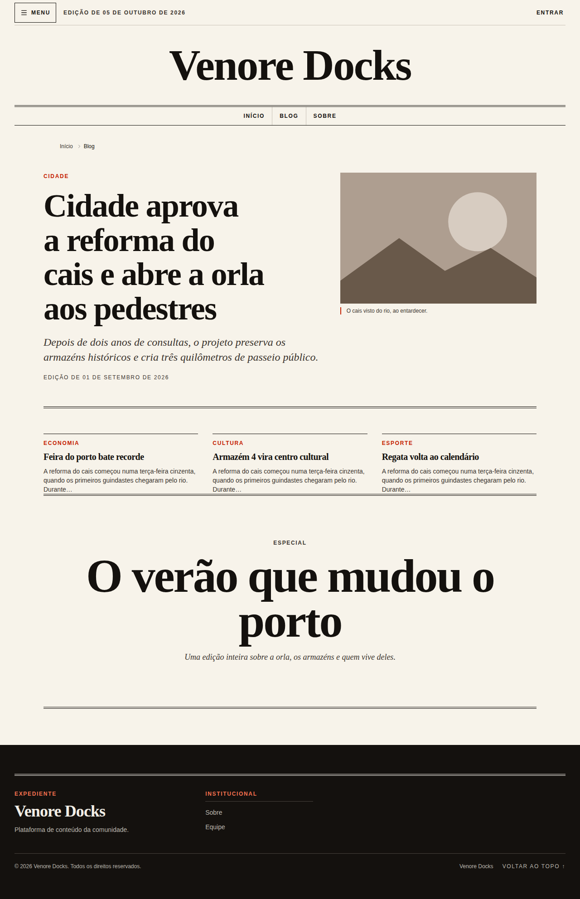

# @venore/theme-editorial

**Editorial** — tema do [Venore Docks](https://github.com/venore-docks/venore-docks) com estética de
jornal/revista: papel quente e tinta preta, um único acento (vermelhão), manchetes serifadas
(Fraunces) sobre corpo sem serifa (Inter), cantos retos, fios e muito respiro. Contrato de tema
**8.0.0** (`docs/themes/theme-system-v8.md` no core).



## O que muda em relação ao kit (Venore Slime) e à Aurora

| | Slime (kit) | Aurora | Editorial |
|---|---|---|---|
| Arranjo | `topbar` | `rail` | componente próprio, coluna única |
| Menu principal | rail lateral | rail escura | sumário de tela cheia (todas as larguras) |
| Cabeçalho | barra compacta | barra sobre o conteúdo | nameplate centrado, data da edição, faixa de seções entre fios |
| Barra contextual | lateral | lateral | faixa "Nesta seção" acima do texto |
| Rodapé | marca + sitemap | kit | expediente em colunas, em tinta |
| Templates | kit | kit | primeira página, matéria longa, índice |

## Instalação

No `package.json` da instância: `"@venore/theme-editorial": "git+https://github.com/venore-docks/venore-theme-editorial.git#v0.1.0"`,
depois `npm install` e ativar em `/admin/themes`.

## Opções (`/admin/themes/customize`)

- **Cor de destaque** — vermelhão (padrão), cobalto, musgo ou só tinta. Uma paleta ativa do
  admin continua vencendo em `--primary`.
- **Fonte das manchetes** — serifada ou sem serifa.
- **Densidade** — arejada ou compacta (encolhe a unidade de espaçamento dentro do layout).
- **Capitular** — letra inicial grande no primeiro parágrafo das matérias.
- **Navegação mobile** — tela cheia (padrão) ou barra inferior do kit.

Estilos de seção do page builder: `newsprint` (papel-jornal) e `ink` (tinta). Variantes de bloco:
hero `front-page` e card `clipping`.

## Estrutura

```
manifest.ts          manifesto 8.0.0 (layout custom, opções, fontes, SEO, outlets)
theme.ts             defineTheme: layout, regiões, templates, mensagens, paletas
theme.css            tokens (claro/escuro), opções, estilos de seção, variantes, prosa
components/          layout, header, footer, contextual-bar, mobile-nav (+ 2 peças client)
templates/           home, entry, category
messages.ts          catálogos pt-BR e en
```

## Validação

Num checkout do core com o pacote instalado: `npx tsx scripts/theme-check.ts --theme editorial`.
O workflow `.github/workflows/theme-check.yml` roda o mesmo gate do core; `tag-release.yml` cria a
tag `v<version>` quando a versão sobe no `main`.
